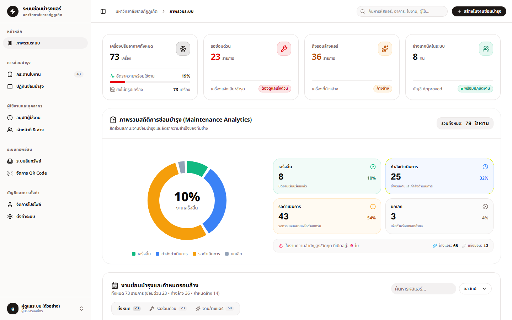
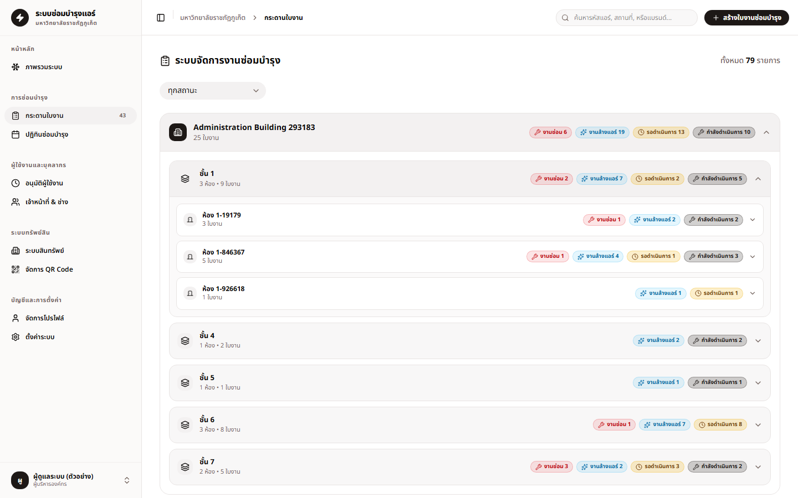
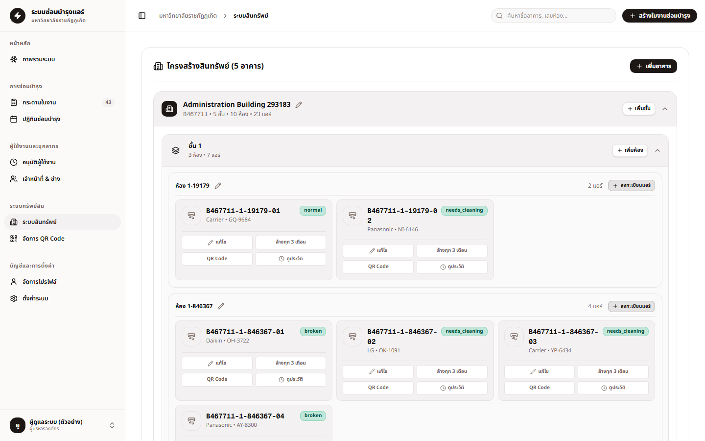
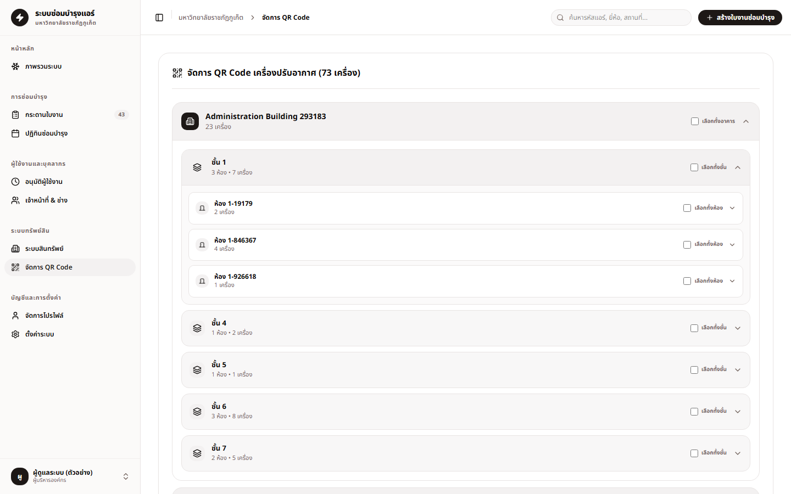
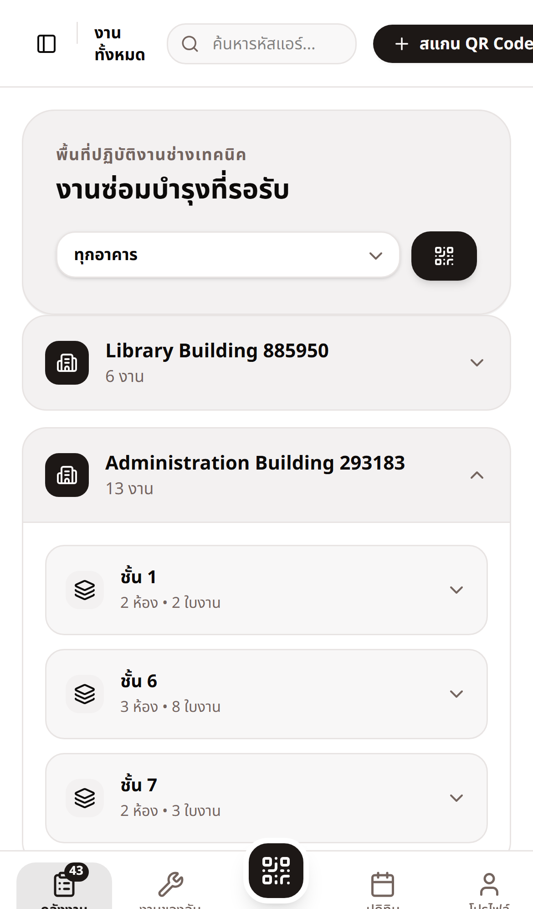
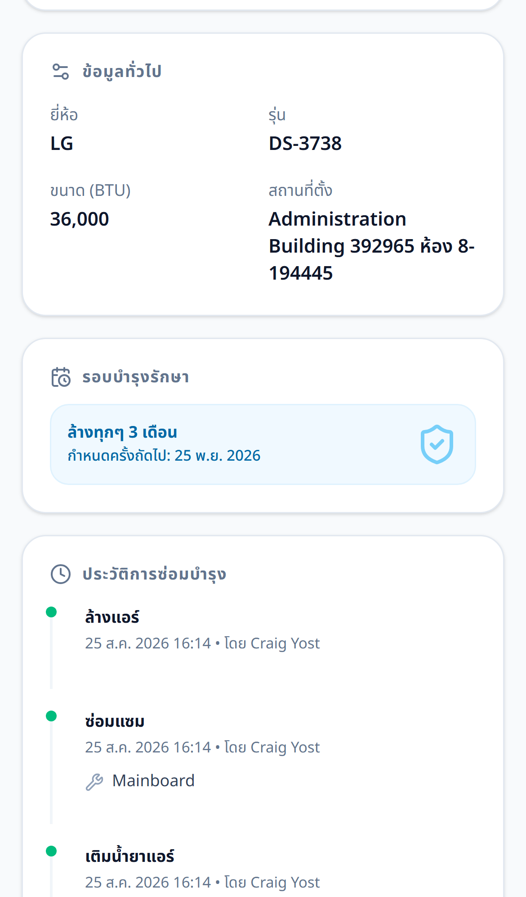
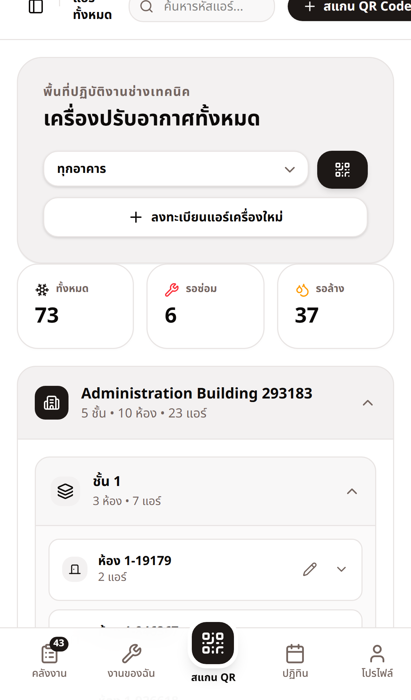

# AC Maintenance System

ระบบบริหารจัดการและแจ้งซ่อมเครื่องปรับอากาศด้วย QR Code สำหรับมหาวิทยาลัยราชภัฏภูเก็ต

**Live Demo:** <https://ac-maintenance-rho.vercel.app>
(หน้าแอดมินและหน้าช่างต้องเข้าสู่ระบบ — สมัครบัญชีได้จากหน้า login แล้วรอผู้ดูแลอนุมัติ)

ติด QR Code ไว้ที่ตัวเครื่องปรับอากาศแต่ละเครื่อง ช่างสแกนหน้างานด้วยมือถือเพื่อดูประวัติ
รับงาน และบันทึกผลการซ่อมบำรุงได้ทันที ส่วนผู้ดูแลระบบจัดการสินทรัพย์ ออกใบงาน
และติดตามสถานะภาพรวมได้จากหน้าจอเดสก์ท็อป

## ฟีเจอร์หลัก

- **สแกน QR Code ที่ตัวแอร์** — เปิดประวัติและสถานะของเครื่องนั้นได้ทันทีจากกล้องมือถือ
- **กระดานใบงาน** — แจ้งซ่อม/ล้างแอร์ มอบหมายช่าง และติดตามสถานะตั้งแต่รอรับงานจนเสร็จ
- **ช่างรับงานและบันทึกผลจากมือถือ** — แนบรูปก่อน/หลังซ่อม และบันทึกรายละเอียดงาน
- **ปฏิทินซ่อมบำรุง** — ตั้งรอบล้างแอร์ล่วงหน้า และแจ้งเตือนเครื่องที่เลยกำหนด
- **จัดการสินทรัพย์** — อาคาร → ชั้น → ห้อง → เครื่อง พร้อมยี่ห้อ/รุ่น/BTU
- **พิมพ์สติกเกอร์ QR Code** — สร้างแผ่นสติกเกอร์สำหรับติดเครื่องได้ทีละหลายใบ
- **แดชบอร์ดภาพรวม** — สัดส่วนสถานะงาน อัตราความสำเร็จของทีมช่าง และเครื่องที่ใกล้ถึงรอบซ่อมบำรุง
- **ระบบสมาชิก** — สมัคร ยืนยันอีเมล รออนุมัติ และแยกสิทธิ์แอดมิน/ช่าง

## หน้าจอ

**ผู้ดูแลระบบ (เดสก์ท็อป)**

| แดชบอร์ดภาพรวม | กระดานใบงาน |
|---|---|
|  |  |
| **จัดการสินทรัพย์** | **พิมพ์สติกเกอร์ QR Code** |
|  |  |

**ช่างซ่อมบำรุง (มือถือ)**

| งานที่รอรับ | ข้อมูลและประวัติเครื่องหลังสแกน QR | แอร์ทั้งหมดแยกตามอาคาร |
|---|---|---|
|  |  |  |

> ภาพหน้าจอจากระบบที่รันบนเครื่องกับฐานข้อมูลทดสอบ (ข้อมูลสมมติ)

## บทบาทผู้ใช้

| บทบาท | ใช้งานหลักบน | ทำอะไรได้ |
|---|---|---|
| `org_admin` | เดสก์ท็อป | จัดการอาคาร/ห้อง/เครื่องปรับอากาศ ออกและติดตามใบงาน พิมพ์ QR Code อนุมัติผู้ใช้ ตั้งค่าระบบ |
| `technician` | มือถือ | สแกน QR รับงาน บันทึกผลงานพร้อมรูป ดูประวัติรายเครื่อง แก้ไขโปรไฟล์ |

โครงสร้างสินทรัพย์เป็นลำดับขั้น **อาคาร → ชั้น → ห้อง → เครื่อง**

## เทคโนโลยีที่ใช้

| ส่วน | เวอร์ชัน |
|---|---|
| Next.js (App Router, webpack) | 16.2.11 |
| React / React DOM | 19.2.4 |
| TypeScript | 5.9.3 |
| Prisma ORM + CLI | 7.9.0 |
| Driver adapter | `@prisma/adapter-pg` |
| ฐานข้อมูล (dev) | PostgreSQL 16 (port 5432) |
| NextAuth | 5.0.0-beta |
| Tailwind CSS | v4 |
| UI | shadcn/ui + Radix + `lucide-react` |

สถาปัตยกรรมเป็น Server Components + Server Actions ไม่มี REST API layer
route guard อยู่ที่ `src/proxy.ts` (Next.js 16 เปลี่ยนชื่อมาจาก `middleware.ts`)

## เริ่มต้นใช้งาน

ต้องมี Node.js 20+ และ PostgreSQL 16 ที่เข้าถึงได้

```bash
npm install
```

สร้าง database ด้วย **ICU collation ภาษาไทย** — ต้องทำตอนสร้างเท่านั้น เปลี่ยนทีหลังไม่ได้
และถ้าใช้ค่าเริ่มต้น ชื่อที่ขึ้นต้นด้วยสระหน้า (เ แ โ ใ ไ) จะเรียงผิดทุกหน้าจอ:

```sql
CREATE DATABASE ac_maintenance
  TEMPLATE template0 ENCODING 'UTF8'
  LOCALE_PROVIDER icu ICU_LOCALE 'th-TH'
  LC_COLLATE 'C' LC_CTYPE 'C';
```

> **⚠️ `prisma migrate reset` จะทำลายการตั้งค่านี้เงียบๆ** — มันลบ database แล้วสร้างใหม่จาก
> `template1` ซึ่งไม่ใช่ ICU การเรียงภาษาไทยจะกลับไปผิดโดยไม่มีอะไรฟ้อง
> ถ้าจำเป็นต้องรีเซ็ต ให้ `DROP DATABASE` แล้วรันคำสั่งข้างบนใหม่เอง ตามด้วย `prisma migrate deploy`
>
> ตรวจว่ายังถูกอยู่ได้ด้วย — ต้องได้ `i` กับ `th-TH`:
> ```sql
> SELECT datlocprovider, daticulocale FROM pg_database WHERE datname = 'ac_maintenance';
> ```

สร้างไฟล์ `.env` ที่ root:

```env
DATABASE_URL="postgresql://postgres:<รหัสผ่าน>@127.0.0.1:5432/ac_maintenance"
AUTH_SECRET="<สร้างด้วย npx auth secret>"
```

เตรียมฐานข้อมูลแล้วเปิด dev server:

```bash
npx prisma migrate deploy
npx prisma generate
npm run dev
```

เปิด http://localhost:3000

### ข้อมูลตัวอย่าง (ไม่บังคับ)

เพิ่มรหัสผ่านของบัญชีตัวอย่าง (`admin@pkru.ac.th` / `tech@pkru.ac.th`) ลงใน `.env` ก่อน (อย่างน้อย 12 ตัวอักษร):

```env
SEED_PASSWORD="<ตั้งรหัสเอง>"
```

```bash
npx tsx prisma/seed.ts
```

> **คำเตือน:** `prisma/seed.ts` สั่ง `deleteMany()` ล้างข้อมูลเดิมก่อนเสมอ
> ใช้กับฐานข้อมูล dev เท่านั้น ห้ามรันใส่ฐานข้อมูลที่มีข้อมูลจริง
> สคริปต์จะไม่ยอมรันถ้า `NODE_ENV=production` หรือ `DATABASE_URL` ไม่ได้ชี้ไปที่ `localhost`
> (ถ้าเป็นฐานข้อมูล dev บนคลาวด์จริงๆ ให้ตั้ง `SEED_ALLOW_REMOTE=yes-wipe-this-database`)

## คำสั่งที่ใช้บ่อย

| คำสั่ง | ทำอะไร |
|---|---|
| `npm run dev` | เปิด dev server |
| `npm run build` | build สำหรับ production (อย่ารันขณะ dev server เปิดอยู่) |
| `npm run lint` | ตรวจด้วย ESLint |
| `npx tsc --noEmit` | ตรวจชนิดข้อมูล |
| `npx prisma migrate status` | ดูว่า migration ตรงกับฐานข้อมูลหรือยัง |
| `npx prisma studio` | เปิดหน้าจอดูข้อมูลในฐานข้อมูล |

## โครงสร้างโปรเจกต์

```
src/
  app/          หน้าเว็บทั้งหมด (App Router) + Server Actions
  components/   คอมโพเนนต์ UI แยกตาม admin / tech / shared / ui
  lib/          ตรรกะฝั่งเซิร์ฟเวอร์ (ตัวจริงของ Server Actions อยู่ที่นี่)
  hooks/        React hooks ที่ใช้ร่วมกัน
  proxy.ts      route guard ตามบทบาท
prisma/
  schema.prisma ฐานข้อมูล 12 model
  migrations/   ประวัติการแก้สคีมา
  seed.ts       ข้อมูลตัวอย่างสำหรับ dev
```

## เอกสารประกอบ

| ไฟล์ | เนื้อหา |
|---|---|
| [HANDOFF.md](HANDOFF.md) | **บันทึกการทำงานและ source of truth ของโปรเจกต์ — อ่านก่อนเริ่มงานเสมอ** |
| [PRODUCT.md](PRODUCT.md) | ขอบเขตผลิตภัณฑ์ ผู้ใช้ และหลักการออกแบบ |
| [design.md](design.md) | ระบบดีไซน์ สี ตัวอักษร และกติกาของ UI |
| [AGENTS.md](AGENTS.md) | กติกาสำหรับ AI agent ที่เข้ามาช่วยพัฒนา |
